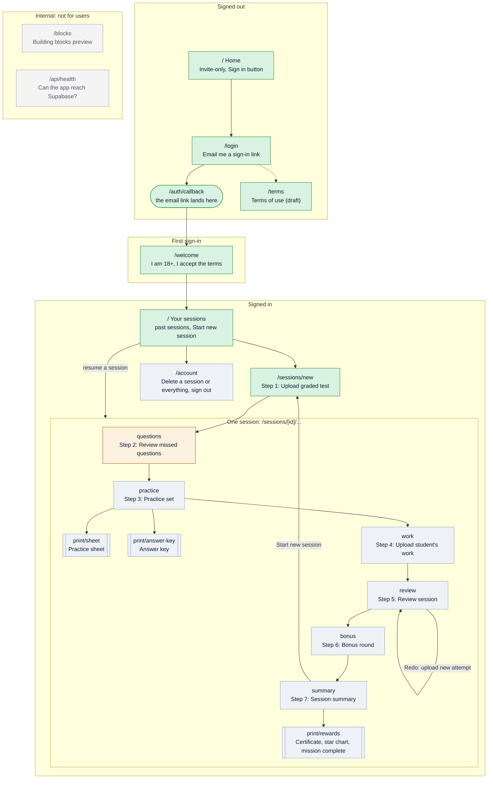
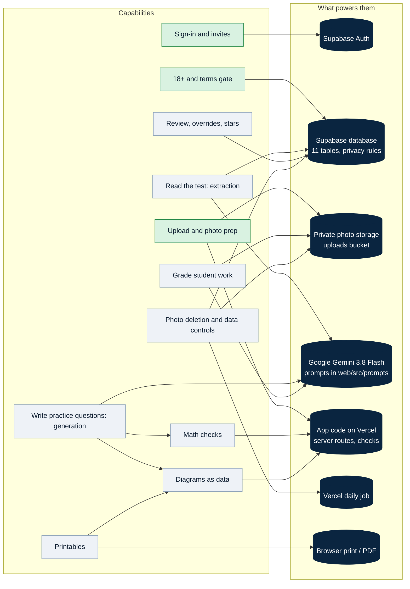

# Math Mission Site Map

**The map of everything the app does:** its pages, what the adult does on each one, and the capabilities behind them. Check here before building anything, whether it's the first build, a change, or a new feature, to see where it fits.

**Last updated:** 2026-10-19 · **Live plan:** [roadmap](roadmap.md) · **Decisions:** [decision log](decisions/README.md)

Diagrams are written in [Mermaid](https://mermaid.js.org). They draw themselves on GitHub and in the Markdown preview of Cursor or VS Code (open this file, then click the preview icon at the top right).

---

## How to use this map

**Before building something**
1. Find where it goes in [the pages](#1-pages) and [the session flow](#2-the-session-step-by-step).
2. Check [capabilities](#3-capabilities) to see what it can reuse and what it would touch.
3. If it's new or changes how something works, add it to [Proposed changes](#proposed-changes) first.

**To ask for a change**
Add a line to [Proposed changes](#proposed-changes), or tell Claude "add this to the site map as proposed". It appears in the diagrams with a dashed purple outline. Once it's agreed, it moves into the plan ([roadmap](roadmap.md)); once built, it turns green here.

**Keeping it true**
Whenever a page or capability is built, changed or dropped, this map is updated in the same commit, with a line in the [change log](#change-log).

**Status key** (used in diagrams and tables)

| Mark | Meaning | Diagram style |
|---|---|---|
| ✅ Built | Live on the site | Green |
| 🟡 Next | Being built now | Amber |
| ⬜ Planned | In the roadmap (phase shown) | Grey |
| 🆕 Proposed | An idea, not yet agreed | Dashed purple outline |

Page addresses for planned pages (like `/sessions/new`) are proposals and may change when built.

---

## 1. Pages

How the pages connect. Arrows are the usual way from one page to the next.

Shapes: rounded = no screen of its own (passes straight through); double-edged = a print page (opens the browser's print dialog, no app bar). Step 2 currently shows the uploaded pages; the missed-questions list arrives with extraction.

### Page list

| Page | What the adult does there | Status |
|---|---|---|
| `/` (signed out) | Reads what the app is; taps Sign in | ✅ Built |
| `/login` | Enters email; gets a sign-in link (a typed code also works once the app has its own email service) | ✅ Built |
| `/auth/callback` | Nothing: the email link signs them in and moves on | ✅ Built |
| `/welcome` | Confirms 18+ and accepts the terms, once (again if the terms change) | ✅ Built |
| `/terms` | Reads the terms | ✅ Built (draft; legal review before Phase 3) |
| `/` (signed in) | Sees past sessions; starts a new one or resumes one | ✅ Built |
| `/sessions/new` | Enters the student's nickname and an assignment name; uploads photos, PDF or screenshots; reminded to cover the student's name | ✅ Built |
| `/sessions/[id]/questions` | Waits while the AI reads the test (progress shown); reviews missed questions: removes, edits, adds; marks "work required" | 🟡 Next: shows the uploaded pages today; extraction and review to come |
| `/sessions/[id]/practice` | Generates the practice set; regenerates or edits any question; sees questions flagged by the math check | ⬜ Planned, Phase 2 |
| `/sessions/[id]/print/sheet` | Prints the practice sheet (letter size, space for work) | ⬜ Planned, Phase 2 |
| `/sessions/[id]/print/answer-key` | Prints the answer key with worked steps | ⬜ Planned, Phase 2 |
| `/sessions/[id]/work` | Uploads photos of the student's finished sheet; grading runs | ⬜ Planned, Phase 2 |
| `/sessions/[id]/review` | Goes through each question with the student: sees the AI's result and grading notes, overrides with one tap, shows hint, uploads a redo, Got it / Move on; pauses and resumes | ⬜ Planned, Phase 2 |
| `/sessions/[id]/bonus` | Runs one extra mirrored question; a win unlocks the special printable | ⬜ Planned, Phase 2 (prize design is open question OQ-6) |
| `/sessions/[id]/summary` | Sees passed, redone and stars earned; completes the session (photos then get deleted) | ⬜ Planned, Phase 2 |
| `/sessions/[id]/print/rewards` | Prints the certificate, star chart and "mission complete" page | ⬜ Planned, Phase 2 |
| `/account` | Deletes one session or all their data; signs out | ⬜ Planned, Phase 2 |
| `/blocks` | (Internal) checks the look of every building block | ✅ Built, hidden on the live site |
| `/api/health` | (Internal) checks the app can reach Supabase | ✅ Built |

Public launch (Phase 4) adds: open sign-up, a landing page, how-it-works, a demo, help and contact, and a privacy policy. These go on the map once they're designed.

---

## 2. The session, step by step

What the adult does in one tutoring session, including the choices along the way. Steps match the spec's core flow (§3).

```mermaid
flowchart TD
  classDef step fill:#eef2f7,stroke:#8aa0b8,color:#0b1b2e
  classDef choice fill:#ffffff,stroke:#0e7490,color:#0b1b2e
  classDef ai fill:#e0f5fa,stroke:#0e7490,color:#0b1b2e
  classDef paper fill:#fdf1df,stroke:#a35a00,color:#0b1b2e

  S1["1. Upload graded test<br/>cover the student's name first"]:::step
  AI1(["AI reads the test<br/>finds missed questions"]):::ai
  S2["2. Review missed questions<br/>remove, edit, add, work required"]:::step
  AI2(["AI writes one practice question per miss<br/>app checks the math"]):::ai
  FLAG{"Math check<br/>passed?"}:::choice
  FIX["Adult regenerates or edits<br/>the flagged question"]:::step
  S3["3. Print practice sheet<br/>and answer key"]:::step
  P1["Student works on paper"]:::paper
  S4["4. Upload student's work"]:::step
  AI3(["AI grades each question<br/>notes for the adult"]):::ai
  S5["5. Review each question<br/>with the student"]:::step
  RESULT{"AI result"}:::choice
  CHECK["Adult decides<br/>Pass or Redo"]:::step
  PASS["Pass: +1 star"]:::step
  REDO["Redo: show hint"]:::step
  P2["Student tries again on paper"]:::paper
  RETRY{"Upload new attempt<br/>or move on?"}:::choice
  GOTIT["Got it: +0.5 star"]:::step
  MOVEON["Move on"]:::step
  MORE{"More questions?"}:::choice
  S6["6. Bonus round<br/>one fresh mirrored question"]:::step
  S7["7. Summary<br/>complete the session"]:::step
  PRINT["Print rewards<br/>certificate, star chart"]:::paper
  DEL(["Photos deleted"]):::ai

  S1 --> AI1 --> S2 --> AI2 --> FLAG
  FLAG -- "yes" --> S3
  FLAG -- "no, after retries" --> FIX --> S3
  S3 --> P1 --> S4 --> AI3 --> S5 --> RESULT
  RESULT -- "Pass" --> PASS
  RESULT -- "Needs your check" --> CHECK
  RESULT -- "Redo" --> REDO
  CHECK --> PASS
  CHECK --> REDO
  REDO --> P2 --> RETRY
  RETRY -- "upload: AI grades again" --> GOTIT
  RETRY -- "move on" --> MOVEON
  PASS --> MORE
  GOTIT --> MORE
  MOVEON --> MORE
  MORE -- "yes" --> S5
  MORE -- "no" --> S6 --> S7 --> PRINT
  S7 --> DEL
```

Key: blue rounded = the app or AI working; amber = happens on paper, off screen; diamonds = a choice. The adult can override any result with one tap at any time, which adjusts stars and progress (decision 003). The session can be paused and resumed at any step.

---

## 3. Capabilities

What the app can do behind the pages, and what powers each capability. A capability is used by one or more pages; a change to a capability affects every page that uses it.

### Capability details

| Capability | What it does | Used on | Powered by | Decisions | Status |
|---|---|---|---|---|---|
| **Sign-in and invites** | Invite-only accounts; email sign-in link; sign-out; keeps logins fresh | `/login`, `/auth/callback`, every signed-in page | Supabase Auth, `npm run invite`, `web/src/proxy.ts` | 001 | ✅ Built (own email service: Phase 3) |
| **18+ and terms gate** | Nothing works until the adult confirms 18+ and accepts the current terms; the database refuses data until then | `/welcome`, every signed-in page | `profiles` table, database privacy rules, `web/src/lib/auth.ts` | 011 | ✅ Built |
| **Upload and photo prep** | Takes photos, PDFs, screenshots, several pages; strips GPS and other metadata; fixes rotation; splits PDFs; resizes; shows progress | `/sessions/new`, `/work`, `/review` (redo) | In the browser (`web/src/lib/upload/`), then straight to the private `uploads` bucket; a server action saves the rows | 006 | ✅ Built for `/sessions/new` (reused later by `/work` and `/review`) |
| **Read the test (extraction)** | Finds every question, which were missed, the student's answer, partial credit, pictures, "work required" | `/questions` | Gemini + `extraction` prompt; `assignments`, `extraction_results`, `questions` tables | 002, 009 | ⬜ Phase 2 (prompt benchmarked) |
| **Write practice questions (generation)** | One mirrored question per miss: same wording and order, new numbers or diagram, a different answer; regenerate or edit | `/practice`, `/bonus` | Gemini + `generation` prompt; `generated_questions` table | 010 | ⬜ Phase 2 (prompt benchmarked 2026-10-19) |
| **Math checks** | Checks each generated question is right before it's shown; retries, then flags for the adult | `/practice`, `/bonus` | App code: `web/src/lib/checks/` | 010 | 🟡 Checks written and used by the benchmark; app wiring Phase 2 |
| **Diagrams as data** | The app draws blocks, charts, shapes and letters from data, so their answers can be checked | `/practice`, print pages, `/review` | App code | 010 | ⬜ Phase 2 |
| **Printables** | Practice sheet, answer key, certificate, star chart, mission complete page; clean print layout | `print/*` pages | Browser print; model in `design-explorations/print-reference/` | 011 | ⬜ Phase 2 |
| **Grade student work** | Pass / redo / needs your check / skipped per question, with notes for the adult | `/work`, `/review` | Gemini + `grading` prompt; `student_submissions`, `submission_pages`, `attempts` tables | 003 | ⬜ Phase 2 (prompt benchmarked) |
| **Review, overrides, stars** | One-tap override; hints; progress dots; stars (+1 pass, +0.5 on a retry); pause and resume | `/review`, `/summary` | `session_progress`, `attempts` tables; building blocks | 003, 011 | ⬜ Phase 2 |
| **Photo deletion and data controls** | Deletes photos when a session completes or after 30 days; delete one session or everything | `/summary`, `/account` | Vercel daily job, storage, database | 006 | ⬜ Phase 2 |

### Behind the scenes (no page)

| What | Why | Status |
|---|---|---|
| Database privacy rules | Each adult only ever reaches their own rows and files (checked by `npm run db:test`) | ✅ Built |
| Theme and building blocks (`web/src/theme/`, `web/src/components/ui/`) | Every page shares one look; restyle in one place | ✅ Built |
| Benchmark (`npm run bench`) | Tests prompts and AI models on real samples before a change goes live: extraction, grading, generation | ✅ Built |
| Daily photo-deletion job | Decision 006 | ⬜ Phase 2 |
| Error tracking, spending cap, own email service | Running safely with other families | ⬜ Phase 3 |

---

## Proposed changes

Ideas waiting for a decision. Add a row here (or ask Claude to); it also gets a dashed purple node in the diagrams above, linked to where it would fit.

| Date | Change | Where it fits | Asked by | Status |
|---|---|---|---|---|
| | *(none yet)* | | | |

When a proposal is agreed, it moves into the [roadmap](roadmap.md) (and a decision record if it changes how the app works), and its status here becomes ⬜ Planned.

## Open questions that affect the map
- **Bonus Round prize** (spec OQ-6): what the printable reward looks like. Affects `/bonus` and `print/rewards`.
- **Offline review** (spec §6.1): drop it, or allow viewing already-graded results offline? Affects `/review`.

## Change log

| Date | Change |
|---|---|
| 2026-10-19 | Upload page, sessions list and photo prep built; Step 2 shows uploaded pages |
| 2026-10-19 | Generation prompt and math checks written and benchmarked (capabilities table) |
| 2026-10-19 | Site map created: pages built in Phase 1, pages planned for Phase 2 (from spec v1.1, backend doc and roadmap), session flow, capabilities |
